# 机器学习方法

> 李航 著 | 清华大学出版社

## 目录

### 前置
- [[00-目录与前言.md]]

### 第一篇：监督学习
- [[chapters/Ch01-机器学习及监督学习概论.md|第1章 机器学习及监督学习概论]]
- [[chapters/Ch02-感知机.md|第2章 感知机]]
- [[chapters/Ch03-$k$ 近邻法.md|第3章 $k$ 近邻法]]
- [[chapters/Ch04-朴素贝叶斯法.md|第4章 朴素贝叶斯法]]
- [[chapters/Ch05-决策树.md|第5章 决策树]]
- [[chapters/Ch06-逻辑斯谛回归与最大熵模型.md|第6章 逻辑斯谛回归与最大熵模型]]
- [[chapters/Ch07-支持向量机.md|第7章 支持向量机]]
- [[chapters/Ch08-Boosting.md|第8章 Boosting]]
- [[chapters/Ch09-EM 算法及其推广.md|第9章 EM 算法及其推广]]
- [[chapters/Ch10-隐马尔可夫模型.md|第10章 隐马尔可夫模型]]
- [[chapters/Ch11-条件随机场.md|第11章 条件随机场]]
- [[chapters/Ch12-监督学习方法总结.md|第12章 监督学习方法总结]]

### 第二篇：无监督学习
- [[chapters/Ch13-无监督学习概论.md|第13章 无监督学习概论]]
- [[chapters/Ch14-聚类方法.md|第14章 聚类方法]]
- [[chapters/Ch15-奇异值分解.md|第15章 奇异值分解]]
- [[chapters/Ch16-主成分分析.md|第16章 主成分分析]]
- [[chapters/Ch17-潜在语义分析.md|第17章 潜在语义分析]]
- [[chapters/Ch18-概率潜在语义分析.md|第18章 概率潜在语义分析]]
- [[chapters/Ch19-马尔可夫链蒙特卡罗法.md|第19章 马尔可夫链蒙特卡罗法]]
- [[chapters/Ch20-潜在狄利克雷分配.md|第20章 潜在狄利克雷分配]]
- [[chapters/Ch21-PageRank 算法.md|第21章 PageRank 算法]]
- [[chapters/Ch22-无监督学习方法总结.md|第22章 无监督学习方法总结]]

### 第三篇：深度学习
- [[chapters/Ch23-前馈神经网络.md|第23章 前馈神经网络]]
- [[chapters/Ch24-卷积神经网络.md|第24章 卷积神经网络]]
- [[chapters/Ch25-循环神经网络.md|第25章 循环神经网络]]
- [[chapters/Ch26-序列到序列模型.md|第26章 序列到序列模型]]
- [[chapters/Ch27-预训练语言模型.md|第27章 预训练语言模型]]
- [[chapters/Ch28-生成对抗网络.md|第28章 生成对抗网络]]
- [[chapters/Ch29-深度学习方法总结.md|第29章 深度学习方法总结]]

## 全书知识图谱

```mermaid
graph TD
  Book["机器学习方法"]
  Book --> P1["监督学习"]
  P1 --> Ch1["Ch1: 机器学习及监督学习概论..."]
  P1 --> Ch2["Ch2: 感知机..."]
  P1 --> Ch3["Ch3: $k$ 近邻法..."]
  P1 --> Ch4["Ch4: 朴素贝叶斯法..."]
  P1 --> Ch5["Ch5: 决策树..."]
  P1 --> Ch6["Ch6: 逻辑斯谛回归与最大熵模型..."]
  P1 --> Ch7["Ch7: 支持向量机..."]
  P1 --> Ch8["Ch8: Boosting..."]
  P1 --> Ch9["Ch9: EM 算法及其推广..."]
  P1 --> Ch10["Ch10: 隐马尔可夫模型..."]
  P1 --> Ch11["Ch11: 条件随机场..."]
  P1 --> Ch12["Ch12: 监督学习方法总结..."]
  Book --> P13["无监督学习"]
  P13 --> Ch13["Ch13: 无监督学习概论..."]
  P13 --> Ch14["Ch14: 聚类方法..."]
  P13 --> Ch15["Ch15: 奇异值分解..."]
  P13 --> Ch16["Ch16: 主成分分析..."]
  P13 --> Ch17["Ch17: 潜在语义分析..."]
  P13 --> Ch18["Ch18: 概率潜在语义分析..."]
  P13 --> Ch19["Ch19: 马尔可夫链蒙特卡罗法..."]
  P13 --> Ch20["Ch20: 潜在狄利克雷分配..."]
  P13 --> Ch21["Ch21: PageRank 算法..."]
  P13 --> Ch22["Ch22: 无监督学习方法总结..."]
  Book --> P23["深度学习"]
  P23 --> Ch23["Ch23: 前馈神经网络..."]
  P23 --> Ch24["Ch24: 卷积神经网络..."]
  P23 --> Ch25["Ch25: 循环神经网络..."]
  P23 --> Ch26["Ch26: 序列到序列模型..."]
  P23 --> Ch27["Ch27: 预训练语言模型..."]
  P23 --> Ch28["Ch28: 生成对抗网络..."]
  P23 --> Ch29["Ch29: 深度学习方法总结..."]
```

