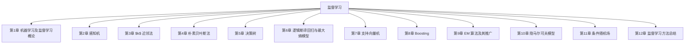

## 第一篇

## 监督学习

## 本篇导读

本篇涵盖第 1 章至第 12 章，共 12 章。

## 本篇章节

- [[../chapters/Ch01-机器学习及监督学习概论.md|第1章 机器学习及监督学习概论]]
- [[../chapters/Ch02-感知机.md|第2章 感知机]]
- [[../chapters/Ch03-$k$ 近邻法.md|第3章 $k$ 近邻法]]
- [[../chapters/Ch04-朴素贝叶斯法.md|第4章 朴素贝叶斯法]]
- [[../chapters/Ch05-决策树.md|第5章 决策树]]
- [[../chapters/Ch06-逻辑斯谛回归与最大熵模型.md|第6章 逻辑斯谛回归与最大熵模型]]
- [[../chapters/Ch07-支持向量机.md|第7章 支持向量机]]
- [[../chapters/Ch08-Boosting.md|第8章 Boosting]]
- [[../chapters/Ch09-EM 算法及其推广.md|第9章 EM 算法及其推广]]
- [[../chapters/Ch10-隐马尔可夫模型.md|第10章 隐马尔可夫模型]]
- [[../chapters/Ch11-条件随机场.md|第11章 条件随机场]]
- [[../chapters/Ch12-监督学习方法总结.md|第12章 监督学习方法总结]]

## 知识图谱

