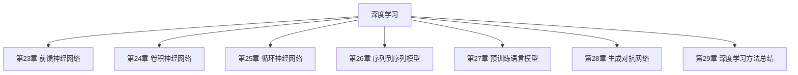

## 第三篇

## 深度学习

## 本篇导读

本篇涵盖第 23 章至第 29 章，共 7 章。

## 本篇章节

- [[../chapters/Ch23-前馈神经网络.md|第23章 前馈神经网络]]
- [[../chapters/Ch24-卷积神经网络.md|第24章 卷积神经网络]]
- [[../chapters/Ch25-循环神经网络.md|第25章 循环神经网络]]
- [[../chapters/Ch26-序列到序列模型.md|第26章 序列到序列模型]]
- [[../chapters/Ch27-预训练语言模型.md|第27章 预训练语言模型]]
- [[../chapters/Ch28-生成对抗网络.md|第28章 生成对抗网络]]
- [[../chapters/Ch29-深度学习方法总结.md|第29章 深度学习方法总结]]

## 知识图谱

