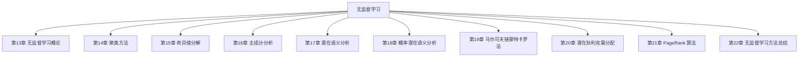

## 第二篇

## 无监督学习

## 本篇导读

本篇涵盖第 13 章至第 22 章，共 10 章。

## 本篇章节

- [[../chapters/Ch13-无监督学习概论.md|第13章 无监督学习概论]]
- [[../chapters/Ch14-聚类方法.md|第14章 聚类方法]]
- [[../chapters/Ch15-奇异值分解.md|第15章 奇异值分解]]
- [[../chapters/Ch16-主成分分析.md|第16章 主成分分析]]
- [[../chapters/Ch17-潜在语义分析.md|第17章 潜在语义分析]]
- [[../chapters/Ch18-概率潜在语义分析.md|第18章 概率潜在语义分析]]
- [[../chapters/Ch19-马尔可夫链蒙特卡罗法.md|第19章 马尔可夫链蒙特卡罗法]]
- [[../chapters/Ch20-潜在狄利克雷分配.md|第20章 潜在狄利克雷分配]]
- [[../chapters/Ch21-PageRank 算法.md|第21章 PageRank 算法]]
- [[../chapters/Ch22-无监督学习方法总结.md|第22章 无监督学习方法总结]]

## 知识图谱

